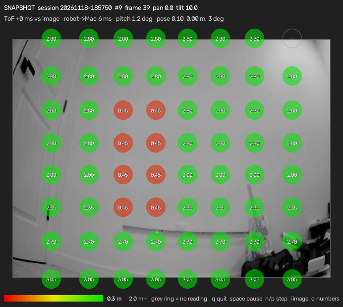

# Monitoring-Sensors

Tools for checking and calibrating the robot's sensors from the Mac. The robot (Robot-RPi-Core) runs
with `debug_mode: true`, sends what its sensors collect to Vision-Microservice on this
Mac, and the tools here read what the service stored. They make no network calls and
put no load on the robot.

```
 Robot (Pi)                         Mac
 camera frame + ToF grid  ──HTTP──▶ Vision-Microservice  ──files──▶  sensor_view.py
 robot_core/debug_upload.py          POST /v1/debug/frame             (this repo)
 at most 2 a second                  debug/<session>/000001.jpg|json
```

## calibrate.py: checks and calibration

One script for every hardware check and calibration (it replaces Robot-RPi-Core's
old `tests/hardware/` scripts). It needs nothing installed beyond Python 3. The `tof`
overlay picture and the `service` latency test use OpenCV from `requirements.txt`.

```bash
python3 calibrate.py           # a menu
python3 calibrate.py all       # check, encoders, imu, tof, tfluna, head, drive
python3 calibrate.py drive     # or one mode: check | encoders | imu | tof | tfluna | head | drive | service
```

**What it does:**
1. It asks whether the Pi is on, then connects with `ssh`. Your Pi's address is asked once and kept in `~/.config/robot-calibrate.json`; change it with `--host user@pi`, and the repo path with `--repo`.
2. It offers to stop `robot-voice` (`sudo` may ask for the Pi's password) and runs `robot_core/calibrate_pi.py` on the Pi through the same SSH session.
3. For each step it says what to do and counts down; press Enter to start early.
4. The robot measures with its own sensors:
   - the gyro measures turns
   - encoders count the tracks
   - the ToF sweeps a wall for pan zero, and the floor for tilt zero and the head's height
   - the TF-Luna reads the floor
5. You use a tape only in `drive`: from the wall to the ToF before and after the robot backs away 1 m.
6. At the end it prints the `robot.yaml` lines to change (with the old value and why), and any firmware constant. It saves the run in `calibrations/<time>.json`, then offers to start `robot-voice` again.

It never edits `robot.yaml` or moves the robot without asking first. Ctrl-C skips the current step.

Modes and what each sets are listed in Robot-RPi-Core's README, "Calibration and checks".
`service` checks Vision-Microservice on this Mac (health, detect latency) and needs no Pi.

## sensor_view.py: camera + ToF overlay



The camera frame in black and white, with the 8x8 ToF grid laid over it as dots:
**red = close** (0.3 m or less), yellow in between, **green = far** (2 m or more), and a
grey ring where the sensor gave no reading. Each dot carries its range in metres. If the
red dots sit on the box in the picture, the ToF and the camera agree.

The header shows the frame number, head pan and tilt, how much older or newer the ToF
grid is than the image, how long the upload took from the robot to the Mac, and the
robot's pitch and pose.

### Setup (once)

```bash
cd ~/src/Monitoring-Sensors
python3 -m venv .venv && .venv/bin/pip install -r requirements.txt
```

### Run

```bash
.venv/bin/python sensor_view.py                     # live: the newest upload, as it arrives
.venv/bin/python sensor_view.py --list              # saved sessions
.venv/bin/python sensor_view.py --session 20261118-104200   # step through one
.venv/bin/python sensor_view.py --snapshot view.png # newest upload to a PNG, no window
```

Keys: `q` / `Esc` quit · `space` pause or play · `n` / `p` or the arrow keys step ·
`i` image on/off · `d` range numbers on/off · `s` save the view as a PNG.
Stepping while live pauses and moves through the current session.

It reads `../Vision-Microservice/debug` by default (the two repos side by side in
`~/src`). Point it elsewhere with `--data <folder>` or `VS_DEBUG_DIR`.

### Turning debug mode on

On the robot, `ros2_ws/src/robot_bringup/config/robot.yaml`:

```yaml
/voice:
  ros__parameters:
    debug_mode: true
```

Then restart the robot (`sudo systemctl restart robot-voice`). Uploads start with the
next task that uses the camera or the ToF (follow, enroll, match). The service keeps the
newest 20 sessions (`VS_DEBUG_KEEP`).

### How the overlay is placed

Each ToF zone is drawn where its centre direction lands in the camera image: the grid
covers 60 x 60 degrees in 7.5-degree zones, and the camera's horizontal field of view
(`hfov_deg` in robot.yaml, 66 by default) gives the pixel scale. Zones outside the
camera's view (the ToF sees further up and down than the camera) are drawn in the margin.
The few centimetres between the ToF and the camera are ignored, so up close (under about
0.5 m) the dots sit slightly off what they measure.
